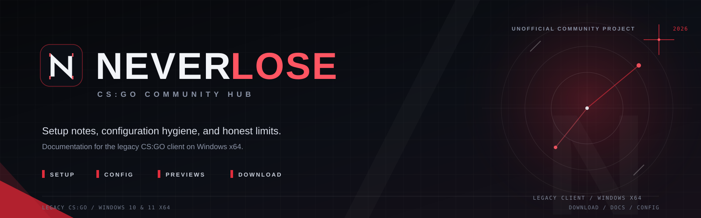
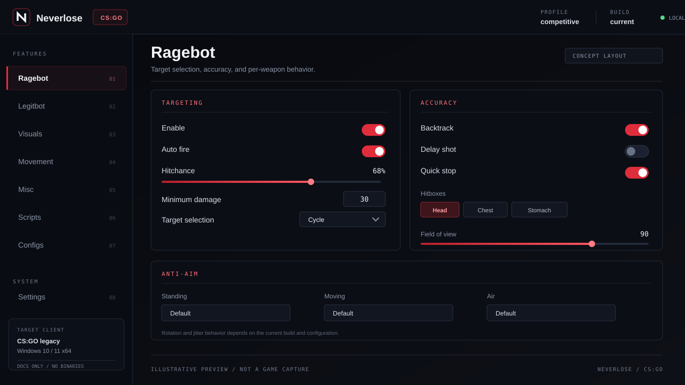
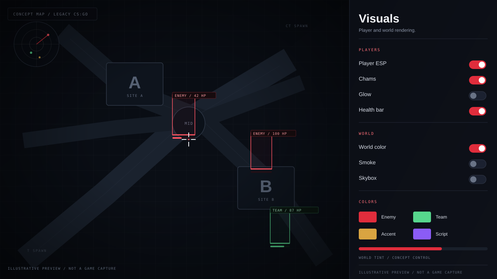

  

<h1 align="center">Neverlose</h1>

  <strong>An independent community hub for Neverlose on CS:GO.</strong> 
  Setup guidance, configuration hygiene, interface concepts, and one download folder.

  

  
  
  
  

> **Unofficial community project.** This repository is not affiliated with
> Neverlose or Valve. It does not contain a loader, DLL, executable, cheat
> source, game binaries, or license keys. Neverlose is a third-party product;
> this hub documents it and links to the download folder used by the project.

Neverlose is a third-party CS:GO package with a reputation built around deep
customization and a large configuration surface. Most problems people run into
are not mysterious: they come from the wrong game build, an incomplete archive
extraction, a stale config, or an overlay conflict.

This repository collects the missing operating manual: a clean installation
path, configuration backup habits, troubleshooting steps, and honest
limitations. It is a documentation hub, not a vendor storefront.

## Download

  

The linked folder is the only distribution point referenced by this hub. Avoid
reuploads, shortened URLs, and files sent through direct messages. If the folder
is unavailable, open a documentation issue instead of trusting a mirror.

## At a glance

| Item | Details |
| --- | --- |
| Product | Neverlose for CS:GO |
| Repository scope | Community documentation, previews, and setup notes |
| Target platform | Windows 10 or 11, x64 |
| Target game | Legacy CS:GO client; CS2 is not covered |
| Distribution | External download folder linked above |
| Support | Community documentation only; no vendor account support |
| Account risk | Third-party software can lead to a VAC or game ban |

## Preview

  

Menu concept: a configuration-first layout with clear feature groups.

  

Visual concept: readable target information without visual noise.

Both images are original interface concepts. They are not game captures, vendor
screenshots, or evidence of current in-game behavior.

## Feature areas

Neverlose is commonly discussed in terms of the areas below. The current build
is the source of truth; this hub does not guarantee that every option is present
or unchanged.

| Area | What it covers |
| --- | --- |
| Ragebot | Target selection, hitchance controls, backtracking, and anti-aim |
| Legitbot | Smoothing, humanization, trigger discipline, and visibility checks |
| Visuals | Player ESP, chams, glow, world modulation, and smoke control |
| Movement | Bunnyhop, edge jump, ladder movement, and slide options |
| Misc | Utility automation, event logging, and quality-of-life toggles |
| Scripts | Lua scripting for custom logic and interface additions |
| Configs | Profiles, backups, per-build settings, and portability habits |

Feature names follow the community's common vocabulary. They are not a promise
about the current build, and they are not instructions for bypassing anti-cheat.

## Quick start

1. Confirm you are running the legacy CS:GO client. CS2 is a different game and
   is not covered by this hub.
2. Open the download folder and get the current archive.
3. Extract it to a short local path, outside the Steam library.
4. Read the instructions included with the build before launching anything.
5. Start CS:GO in borderless or windowed mode if you plan to use an overlay.
6. Launch the loader using the build's own instructions and open the menu.
7. Keep a known-good config backup before changing several groups at once.

Detailed steps live in [Installation](docs/installation.md) and
[Configuration](docs/configuration.md).

> **Download hygiene:** do not disable security software, bypass warnings, or
> run files from chat attachments to make a package work. If a file is flagged,
> stop and verify the source.

## Repository map

| Path | Purpose |
| --- | --- |
| [docs/installation.md](docs/installation.md) | Download, extraction, first launch, and cleanup |
| [docs/configuration.md](docs/configuration.md) | Config workflow, backups, and script hygiene |
| [docs/troubleshooting.md](docs/troubleshooting.md) | Symptom-based fixes and issue-report checklist |
| [docs/faq.md](docs/faq.md) | Scope, compatibility, availability, and account risk |
| [docs/safety.md](docs/safety.md) | Download hygiene, privacy, and repository policy |
| [ROADMAP.md](ROADMAP.md) | What is being improved next |
| [CONTRIBUTING.md](CONTRIBUTING.md) | Accepted contributions and quality bar |
| [CHANGELOG.md](CHANGELOG.md) | Changes to this documentation hub |
| [SECURITY.md](SECURITY.md) | Reporting malicious links or data leaks |

## Project status

The hub baseline is `1.0.0` (2026-10-23). Documentation is maintained on a best-
effort basis by the community. This repository does not provide vendor support,
account recovery, or a promise of continued compatibility.

What is planned next is tracked in [ROADMAP.md](ROADMAP.md). Corrections and
original guides are welcome through the issue templates and pull request flow.

## Repository policy

- Documentation, original diagrams, and original interface concepts only.
- No loaders, DLLs, executables, archives, dumped source, or license keys.
- No account credentials, Steam sessions, personal data, or private configs.
- No fake stars, purchased engagement, impersonation, or misleading mirrors.
- No instructions for evading detection, anti-cheat, or platform moderation.
- Broken links and outdated instructions should be reported as issues.

## Account and platform risk

Neverlose is third-party software. Using it with CS:GO can violate Valve's
Steam Subscriber Agreement and lead to a VAC or game ban. No documentation can
guarantee account safety, undetectability, or compatibility with future game
builds. Platform policies and vendor availability can change without notice;
this repository cannot guarantee that any external link remains online.

If the goal is to keep an account clean, the only reliable option is not to load
third-party software into the game.

## Contributing

Read [CONTRIBUTING.md](CONTRIBUTING.md) before opening a pull request. Small,
verifiable corrections are preferred over large rewrites. Security and privacy
reports go through [SECURITY.md](SECURITY.md), not public issues.

## License and trademarks

Repository content is released under the [MIT License](LICENSE). That license
covers this hub's documentation and original assets only; it does not grant any
rights to Neverlose, Counter-Strike, CS:GO, Steam, Valve, or third-party files.

Neverlose, Counter-Strike, CS:GO, Steam, and Valve are trademarks of their
respective owners. This is an unofficial community project.
